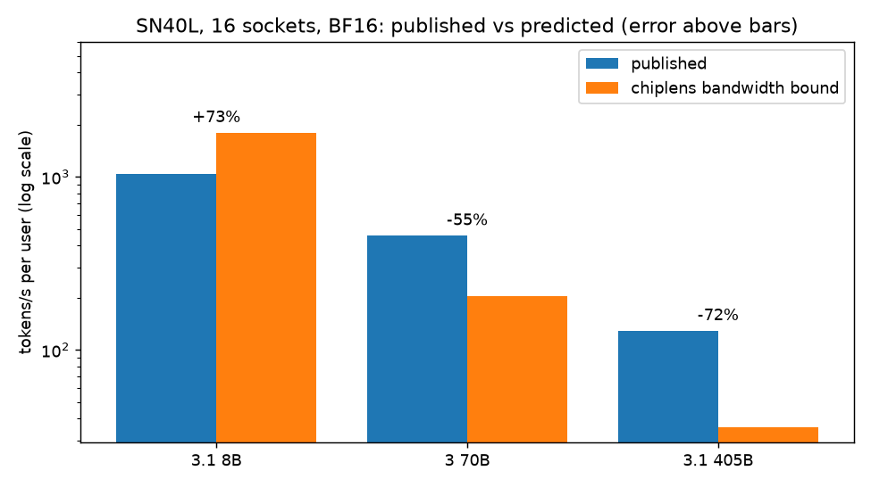
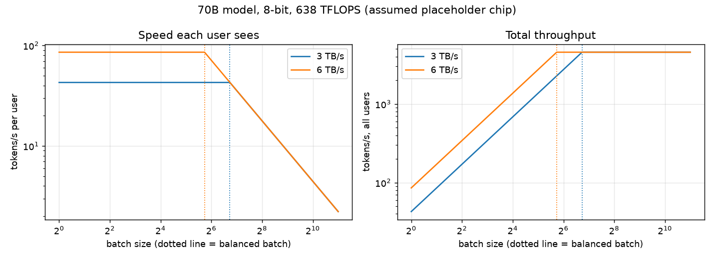

# chiplens

[](https://github.com/OWNER/chiplens/actions/workflows/ci.yml)


<!-- Replace OWNER with your GitHub username once the repo is public. -->

An open-source tradeoff and cost model for AI inference chips, built on cited
public specs, and honest about where it is wrong.

## The problem

People who choose, design or sell AI inference chips keep asking one question:
**for this model, what limits this chip, and what does a token cost?** The answer
depends on memory bandwidth, compute, batch size, KV cache, power and die cost.
Public specs are scattered, often unsourced, and vendor speed claims are hard to
sanity-check.

chiplens puts these in one transparent model:

- **Cited data.** Every chip and model number carries a unit, source URL, date and
  a confidence tag: `published`, `estimated` or `assumed`. Results report which
  tags they depend on.
- **Models** (pure Python functions): roofline and batching, memory tiers, KV cache,
  power and efficiency, die cost and yield, chiplets, operator fusion, economics
  with Monte Carlo.
- **Validation.** Predictions are compared with published results and the errors
  are shown, not hidden.
- **Claim auditor.** Checks whether a published tokens/s claim is physically
  possible given the chip's bandwidth or compute.

## Validation result (read this first)

chiplens **does not reproduce** the published SambaNova SN40L decode numbers
(MICRO 2024, Table IV, 16 sockets, BF16). It is an upper-bound model.

| Model | Published (tok/s/user) | chiplens bound | Error |
| --- | ---: | ---: | ---: |
| Llama 3.1 8B | 1,042 | 1,800 | +72.7% |
| Llama 3 70B | 457 | 204 | -55.3% |
| Llama 3.1 405B | 129 | 36 | -72.4% |

The 70B and 405B published runs *beat* the bandwidth bound, which is only possible
if each weight read yields more than one token. The paper says those runs use
speculative decoding, which this model omits. Full report and caveats:
[validation/results.md](validation/results.md). Write-up:
[docs/writeup.md](docs/writeup.md).



## Quickstart

```bash
pip install -e ".[dev,app,plot]"

chiplens list
chiplens run --chip sn40l --model llama31_405b --precision bf16 --sockets 16
chiplens run --chip h100_sxm --model llama3_70b --precision fp8 --batch 16 --context 8192
chiplens audit-user --claim 457 --bandwidth-tb-s 28.8 --weights-gb 140
chiplens economics --chip h100_sxm --model llama3_70b --precision fp8 --batch 2048 --die-area 800
chiplens validate

streamlit run app/streamlit_app.py     # web app
pytest                                  # tests
```

Example:

```
$ chiplens run --chip sn40l --model llama31_405b --precision bf16 --sockets 16
  weights:               810.0 GB (810.0 GB in hbm)
  per-user speed:        35.56 tokens/s
  ASSUMED inputs:        board_power
  note: an optimistic upper bound, not a measurement (docs/methodology.md)
```



## What is modeled, and what is not

| Module | Models | Ignores |
| --- | --- | --- |
| `roofline` | weights read once per token, memory vs compute limit, balanced batch | real utilization, attention FLOPs, prefill |
| `memory_tiers` | HBM/DDR placement, spill cost | tier overlap, prefetch |
| `llm` | parameter count, KV cache size | MoE, KV compression |
| `power` | energy per token, tokens/J, rack capacity | part-load power |
| `diecost` | dies per wafer, Poisson/Murphy yield, chiplets | reticle limit, assembly yield |
| `fusion` | activation traffic and launch overhead | wide MLP intermediates, prefill |
| `economics` | COGS, TCO, cost per token, payback, Monte Carlo | financing, demand, price decline |
| `audit` | bandwidth and compute bounds on claims | everything outside those bounds |

Multi-chip results assume **ideal scaling with no network cost**. Cost inputs are
**all assumed**. Full formulas and blind spots: [docs/methodology.md](docs/methodology.md).
Design choices: [docs/decisions.md](docs/decisions.md).

## Data

```
data/chips/          sn40l.yaml (MICRO 2024 paper), h100_sxm.yaml (NVIDIA page), example_chip.yaml (placeholder)
data/models/         llama3_70b, llama31_405b, llama31_8b
data/assumptions/    cost_example.yaml (every value assumed)
validation/data/     published results used for validation
```

Chip power for the SN40L is a **placeholder tagged `assumed`** because the paper
gives none. H100 dense compute is **estimated** (half of the page's sparse figure).
Add your own chip: [CONTRIBUTING.md](CONTRIBUTING.md).

## Layout

```
src/chiplens/   pure-Python models, catalog, scenario, CLI
app/            Streamlit web app (thin, no modeling code)
data/           YAML with sources and confidence tags
validation/     published results and the generated report
docs/           methodology, decisions, write-up
tests/          hand-worked expected values (160+ tests)
examples/       chart scripts
```

## Status

v1.0.0. See [CHANGELOG.md](CHANGELOG.md). Known gaps and ideas:

- Prefill modeled separately from decode.
- Multi-chip network limits instead of ideal scaling.
- Speculative decoding as a tokens-per-weight-read factor.
- More chips as public data appears (each is a YAML file plus a validation case).
- Verify the SN40L Table IV values against the paper PDF (read from HTML).

## License

MIT. See [LICENSE](LICENSE).
